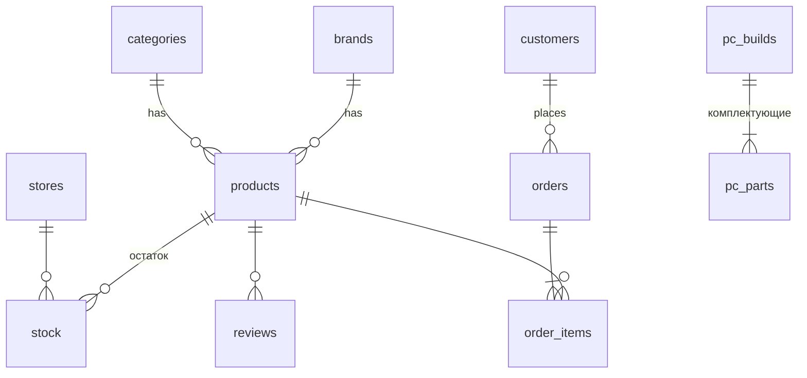

# НоутМаркет: интернет-магазин ноутбуков

## Архитектура
Браузер (HTML/CSS/JS, three.js) → HTTP/JSON API (`server.py`, Python, `http.server`) → SQLite (`shop.db`).
Цены хранятся в сомах (`price_kgs`). Админка `/admin` защищена паролем (заголовок `X-Admin`).

## Схема базы данных

Представление `v_catalog` объединяет товар, бренд, категорию и суммарный остаток (`in_stock`, `availability`).

## API
| Метод и адрес | Назначение |
|---|---|
| GET /api/products | каталог с ценой и остатком |
| POST /api/orders | оформить заказ (цены берутся из БД, остаток списывается в транзакции) |
| GET, POST /api/reviews | отзывы о товаре |
| GET, POST, PUT, DELETE /api/admin/products | управление товарами и остатками |
| GET /api/admin/orders, POST /api/admin/orders/{id}/status | заказы и статусы (отмена возвращает товар на склад) |
| GET /api/admin/stats, POST /api/admin/backup | статистика, резервная копия |

## Возможности
Каталог 50 моделей, поиск, фильтры, сортировка, наличие по магазинам, 3D-модели ноутбуков (three.js), корзина,
заказ на сервере или через WhatsApp/Telegram, сравнение до 3 моделей, избранное, подбор по задаче, рассрочка,
отзывы и рейтинг, админка, статистика, выгрузка в CSV, импорт из Access/CSV, резервные копии, PWA.

## Безопасность
Параметризованные SQL-запросы, проверка данных на сервере, цены и остатки не доверяются клиенту,
экранирование текста в интерфейсе, пароль администратора из переменной окружения, защита от выхода за пределы `static/`.

## Что можно развить
Оплата картой, интерфейс на кыргызском, подписка «сообщить о поступлении», роли сотрудников, HTTPS на сервере.

## Страница ПК
25 сборок системных блоков (`pc_builds`, `pc_parts`, представление `v_pc`). Цена в сомах: цены комплектующих рынка США 2026 года × курс НБКР 87,45 сом за $1,
плюс работа мастера (сборка, кабели, установка ОС, тест). При нажатии на ПК запускается 3D-анимация разбора корпуса (three.js).
